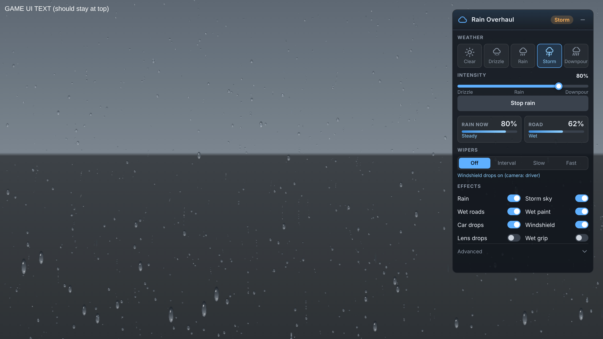

# BeamNG Weather — Rain Overhaul

A BeamNG.drive mod that adds a full rain system:

- **Rain particles.** Two layers of rain follow the camera: thin, dense streaks close to you, plus a farther layer for depth. They use the mod's own high-resolution textures, and there are four quality levels (Low, Medium, High, Ultra).
- **3D splashes.** Instead of the game's flat splash pictures, raindrops hitting the ground throw up tiny water droplets and leave rings that spread flat on the road, all around the camera.
- **Storm sky.** Clouds, fog and wind build up with the rain and go back to the map's sky afterwards.
- **Wet roads.** Asphalt, concrete, road lines, kerbs and similar materials get smoother and gain a glossy water layer (clear coat), so they reflect lights, sky and cars. Wetness builds up over time in rain and dries slowly after it stops. Light rain only makes roads damp.
- **Water drops on cars.** Beads of water on the paint, and bigger drops with short runs on the windows. They show from every camera and fade away as things dry.
- **Wet car body.** All cars' paint gets a strong, smooth clear coat, so the bodywork looks soaked. The original paint comes back when it dries. If you repaint a car in the rain, your new paint is kept.
- **Rain on the windshield.** In the driver camera, drops land on the glass and bend the light like small lenses. Big drops run down and leave wet streaks when you're slow. Above about 45 km/h the airflow pushes them up the glass, and they leave small beads behind.
- **Wipers.** Off, intermittent, slow and fast. They clear the drops they sweep over.
- **Wet grip (experimental, off by default).** Paved surfaces lose grip in 4 steps (dry, damp, wet, soaked). The mod uses the game's own `ASPHALT_WET` values when it can find them.

## Install

1. Get `beamng_weather.zip` (it's in `dist/`, or build it with `tools/build.sh`).
2. Put the zip **as-is, without unzipping it** in your mods folder:
   - Windows: `%LOCALAPPDATA%\BeamNG.drive\<version>\mods\`
     (older versions: `Documents\BeamNG.drive\mods\`)
3. Start the game. Check the mod is enabled in **Mod Manager**.
4. Load a map. Open the **UI Apps** editor (press `Esc`, then *UI Apps*), add **Rain Overhaul** and save your layout.
   **This app has to stay in your layout for windshield rain and wipers to show.**

## Controls



- **App panel (Rain Overhaul):**
  - **Weather presets:** Clear, Drizzle, Rain, Storm, Downpour.
  - **Intensity slider** and a **Start / Stop rain** button.
  - **Live meters:** how hard it's raining now (building up, steady, easing off) and how wet the road is (dry, damp, wet, soaked).
  - **Wipers:** Off, Interval, Slow, Fast.
  - **Effects:** a switch for each part (rain, storm sky, wet roads, wet paint, windshield, lens drops, wet grip).
  - **Advanced:** how long roads take to soak and to dry, buttons to dry or soak the roads instantly, and a reset.
  - The **–** button in the header shrinks the panel to two small meters. Press **+** to open it again.
- **Key bindings:** *Options → Controls → Bindings → Gameplay* lists four actions: *Rain Overhaul: Toggle rain / Heavier rain / Lighter rain / Cycle wipers*. They have no keys by default, so set your own.
- **Console** (`~`):
  ```lua
  beamngWeather_rain.setIntensity(0.8)       -- 0 = dry, 1 = downpour
  beamngWeather_rain.toggleRain()
  beamngWeather_rain.setWetness(1)           -- soaked roads right away
  beamngWeather_rain.setWipers(3)            -- 0 off, 1 intermittent, 2 slow, 3 fast
  beamngWeather_rain.setFeature("grip", false)
  beamngWeather_rain.setRates(45, 240)       -- seconds to get fully wet / to dry
  beamngWeather_wetRoads.dump()              -- list the materials treated as road
  beamngWeather_rain.setQuality("ultra")     -- rain quality: low, medium, high, ultra
  beamngWeather_wetDroplets.dump()           -- list the car materials that get water drops
  beamngWeather_precipitation.useMapLook(true) -- use the map's rain textures instead of the mod's
  beamngWeather_rain.debug()                 -- show what the rain system is doing (send this if rain doesn't show)
  ```

Settings are saved to `settings/beamng_weather.json` in your user folder. Every game session starts dry. The mod changes nothing in the world until a map has been loaded for a few seconds.

**If the game won't start:** remove `beamng_weather.zip` from `mods` or delete `settings/beamng_weather.json`, then send `beamng.log` from your user folder.

## Mod layout

```
mod/
  scripts/beamng_weather/modScript.lua             loads the extension when the mod is on
  lua/ge/extensions/beamngWeather/
    rain.lua            main controller: state, wetness timing, settings, UI data
    precipitation.lua   rain particles and storm sky
    wetRoads.lua        wet road materials
    wetBody.lua         wet vehicle paint (gloss)
    wetDroplets.lua     water drops on vehicle paint and glass
    splashes.lua        3D particle splashes and ripples on the ground
    wetGrip.lua         wet ground-model friction (experimental)
  lua/ge/extensions/core/input/actions/beamngWeather.json   key binding actions
  ui/modules/apps/BeamNGWeatherRain/                         control panel + windshield overlay
  art/beamng_weather/                                        rain drop and splash textures
tools/
  build.sh              builds dist/beamng_weather.zip
  make_textures.py      regenerates the textures (needs Pillow)
```

**Advanced → Diagnostics** in the panel shows what the mod found: rain layers, splash emitters, car paint and glass materials, road materials, and the camera. If something doesn't show in game, send a screenshot of this section.

## Performance

If the game runs slowly in the rain, try these in order:
1. **Advanced → Rain quality → Low or Medium.** This lowers the number of rain drops, ground splashes and windshield drops.
2. Turn off **3D splashes**.
3. Turn off **Windshield**. The windshield overlay makes the game redraw its UI layer while it's raining.

## Known limits and things to test

This mod was written without the game running, so it needs testing in game. Every game call is wrapped in a safety check: if a feature doesn't work in your game version, it turns itself off and writes a line starting `beamngWeather` to the log (`beamng.log`). The rest keeps working.

- **Wet grip** relies on `be:setGroundModel`. Each grip step makes the game reload collision, which can cause a short hitch on big maps. If it misbehaves, turn off *Wet grip* in the app.
- **Wet roads** finds road materials by name (`asphalt`, `road`, `concrete`, `line`...). Some maps name things differently. Use `beamngWeather_wetRoads.dump()` to see what was found. Terrain materials (dirt or asphalt painted onto the terrain itself) aren't changed.
- **No puddles or spray yet.** There are no puddles and no water spray from tyres.
- **Two kinds of windshield drops.** In the driver camera you get the animated overlay with wipers. The drop texture on the glass itself shows from every camera, but it doesn't move or get wiped. The panel shows which camera the mod detects. If your in-car camera isn't recognized, send me the name it shows.
- **Car drops depend on the material slots.** They use a detail normal map. If a car's materials don't use that slot, its drops won't show; `beamngWeather_wetDroplets.dump()` lists the materials that get drops.
- **No rain sound yet,** beyond whatever sound the map's own rain has.
